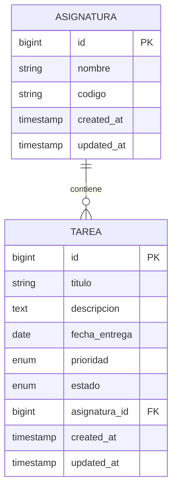

# Adenda de requisitos y diseño — semana 10

Fecha: **27/11/2026, America/Bogota**. Revisión 1 para la entrega técnica. Esta adenda aplica al sistema existente; no atribuye modificaciones documentales a semanas anteriores ni representa una nueva entrevista con el cliente. La estudiante autorizó reconciliar la documentación; su revisión académica final sigue pendiente.

## Fuentes y conservación

- [Requisitos originales, semana 3](Arteaga_Veronica_S3_Requisitos.docx), versión 1.0, 24/10/2026.
- [Diseño original y ADR-001, semana 4](Arteaga_Veronica_S4_Diseño.docx), versión 1.0, 31/10/2026.
- [Decisiones implementadas](DECISIONES.md), [registro de pruebas](../registro_pruebas.md) y código actual.

Los DOCX se conservan sin cambios. SHA-256 S3: `0EF75C469FDC3F9F877C35E042AA45E971204F9325615849B0268C530FBC8582`; S4: `B582F45CFC068119A72AB8FD17A8A5943FB1EA1D4AF2D0A305A7A829832626A9`. La precedencia arquitectónica de S4 ya estaba documentada; la reconciliación explícita siguiente se escribe ahora.

## Sustitución de persistencia y HU-08 revisada

**Cambio del requisito original:** S3 describe almacenamiento local del navegador, un actor de almacenamiento local y recuperación de caché corrupta. S4/ADR-001 adopta Angular → API Laravel → MySQL. MySQL es la fuente persistente actual. Se sustituye el mecanismo y sus criterios, conservando la necesidad de no perder tareas al recargar. No hay modo offline ni copia persistente en localStorage.

**HU-08-R1:** Como estudiante que utiliza la demostración local, quiero conservar asignaturas y tareas en MySQL mediante la API para recuperarlas al recargar la aplicación.

| Criterio revisado | Escenario verificable | Evidencia de implementación/prueba |
|---|---|---|
| CA-08-R1-01 | Dada una asignatura y una tarea creadas correctamente, al recargar la página se hacen nuevas consultas HTTP y se muestran sus valores guardados. | `AcademicoService`, escenarios CRUD/recarga de `frontend/e2e/academica.spec.ts`. |
| CA-08-R1-02 | Dados cambios de datos o estado confirmados por la API, al recargar se conserva el estado persistido. | Escenarios E2E y pruebas Feature de edición/estado. |
| CA-08-R1-03 | Si API o MySQL no están disponibles, se muestra un error recuperable y la opción de reintentar; no se sustituyen datos por registros ficticios ni se borra la información. | Componentes de páginas y escenario E2E explícito de fallo de red. Este último simula la respuesta; no certifica recuperación física de MySQL. |
| CA-08-R1-04 | Tras cerrar y volver a iniciar servicios usando el mismo directorio de datos y configuración, los datos deben conservarse. | Persistencia de MySQL y procedimiento de operación. Debe comprobarse por separado del simple reload del navegador; no se considera probado solo por CA-08-R1-01. |

El antiguo criterio de caché corrupta queda **sustituido**, no declarado aprobado. Un error de base de datos no inicializa listas vacías ni ejecuta limpieza. El sistema de almacenamiento se representa como MySQL en el diseño de contenedores, no como actor externo de localStorage.

RNF-01-R1 conserva el umbral de menos de 1500 ms para 200 registros, medido ahora desde navegación hasta filas visibles con Angular, API HTTP y MySQL. Sus mediciones describen el entorno local documentado, sin promesa de rendimiento público o concurrente.

## Corrección aritmética de la matriz S4

No se alteran pesos ni puntajes de diseño. Se corrigen únicamente los totales calculados como suma de peso × puntaje:

| Atributo | Peso | A: Angular/localStorage | B: Angular/Laravel/MySQL | C: Laravel/Blade/MySQL |
|---|---:|---:|---:|---:|
| Usabilidad | 5 | 4 | 5 | 4 |
| Mantenibilidad | 4 | 3 | 4 | 3 |
| Eficiencia | 4 | 5 | 4 | 4 |
| Persistencia | 5 | 2 | 5 | 5 |
| Escalabilidad | 2 | 2 | 4 | 3 |
| **Total correcto** | | **66** | **90** | **79** |
| Total publicado en S4 | | 63 | 86 | 73 |

B sigue siendo la alternativa de mayor valoración. Los puntajes son valoraciones de diseño, no mediciones. El error fue comprobado durante la auditoría S10; no hay evidencia suficiente para atribuir su origen a IA. ADR-001 permanece vigente y no se cambia retrospectivamente su contenido.

## Formularios y reglas vigentes

| Campo | Obligatorio | Límite/validación |
|---|---|---|
| Asignatura: nombre | Sí | Texto, máximo 150. |
| Asignatura: código | Sí | Texto, máximo 30; no se exige unicidad. |
| Tarea: título | Sí | Texto, máximo 200. |
| Tarea: descripción | Sí | Texto, máximo 5000. |
| Tarea: asignatura_id | Sí | Entero que referencia una asignatura existente. |
| Tarea: fecha_entrega | Sí | Día real `AAAA-MM-DD`; hoy o futuro en Colombia al crear. Al editar puede conservarse exactamente la fecha original vencida; otra fecha debe ser hoy o futura. |
| Tarea: prioridad | Sí | Alta, Media o Baja. |

La expresión de S4 «título o descripción» se reemplaza aquí por **ambos obligatorios**, conforme a la implementación y a la decisión previamente registrada. Los errores establecidos por las historias originales se conservan. El estado se inicia en Pendiente y se actualiza por una operación separada.

Límites pendientes: la interfaz valida longitudes antes de recortar al enviar y la API recibe texto normalizado por middleware; fronteras con blancos exteriores y Unicode complejo requieren una política explícita (A-04/A-05 del registro). Esta adenda no los declara reconciliados ni cambia validadores para mejorar resultados.

## Contrato real de la API

Base local: `http://127.0.0.1:8000/api`. El frontend usa `/api` bajo el proxy local. No existe autenticación ni separación de datos entre estudiantes; solo demostración de un usuario en loopback.

| Método | Ruta | Entrada | Éxito |
|---|---|---|---|
| GET | `/asignaturas` | Sin cuerpo. | 200; orden por nombre/id. |
| POST | `/asignaturas` | nombre y codigo. | 201. |
| GET | `/tareas` | Filtros opcionales prioridad y estado, combinables. | 200; orden por fecha/id. |
| POST | `/tareas` | Los cinco campos del formulario de tarea. | 201; estado inicial Pendiente. |
| PUT | `/tareas/{id}` | **Formulario completo**: titulo, descripcion, fecha_entrega, prioridad y asignatura_id. | 200; conserva estado. |
| PATCH | `/tareas/{id}/estado` | `{"estado":"Completada"}` o uno de los otros dos valores del catálogo. | 200; doble finalización devuelve 422. |
| DELETE | `/tareas/{id}` | Sin cuerpo; confirmación previa en la interfaz. | 204 sin contenido. |

Ejemplo POST/PUT de tarea, usando un id de asignatura existente y una fecha futura:

```json
{
  "titulo": "Informe ficticio de algoritmos",
  "descripcion": "Documentar decisiones y resultados con datos sintéticos.",
  "fecha_entrega": "2030-12-15",
  "prioridad": "Alta",
  "asignatura_id": 1
}
```

Respuestas con cuerpo: `{"data": ...}`. Errores: `{"message":"...","errors":{"campo":["mensaje"]}}`, con `errors` en validaciones. Códigos 404 para recurso ausente, 422 para validación y 500 genérico sin detalles internos. No hay GET individual de tarea ni edición/eliminación de asignaturas.

POST/PUT no deben enviar estado: la regla `prohibited` rechaza valores no vacíos. La política para presencia vacía/null sigue identificada como A-08; no se afirma que cualquier presencia sea rechazada. PATCH no sustituye PUT. Completar dos veces se protege dentro de una transacción con bloqueo de fila; la prueba de concurrencia con conexiones independientes sigue pendiente.

## Modelo de datos reconciliado



La FK restringe borrar una asignatura con tareas. Existen índices de fecha, prioridad/fecha y estado/fecha. La descripción ya estaba en migración, modelo, recursos y formulario; su inclusión aquí corrige la omisión de la imagen del diseño, sin migración nueva ni cambio funcional.
